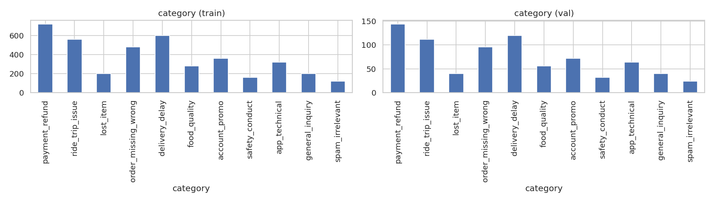
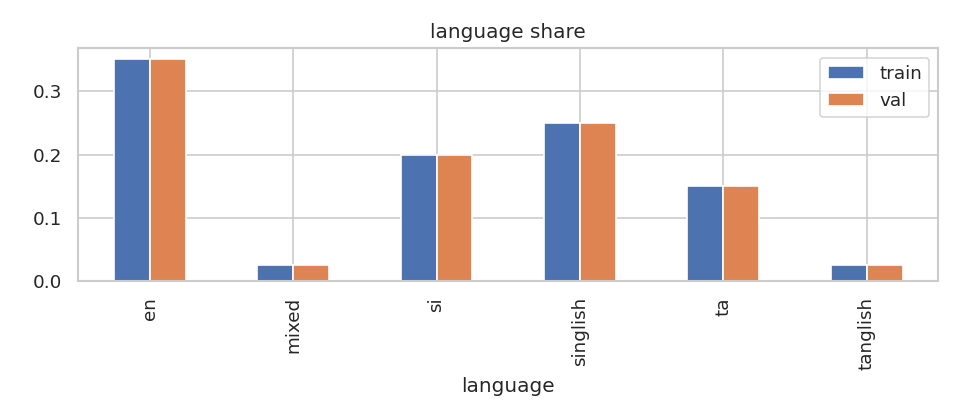
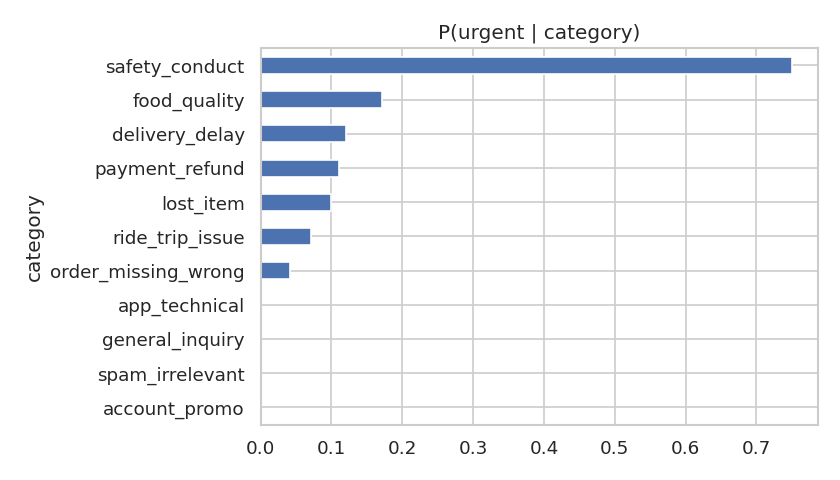
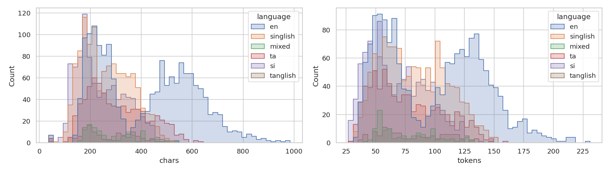
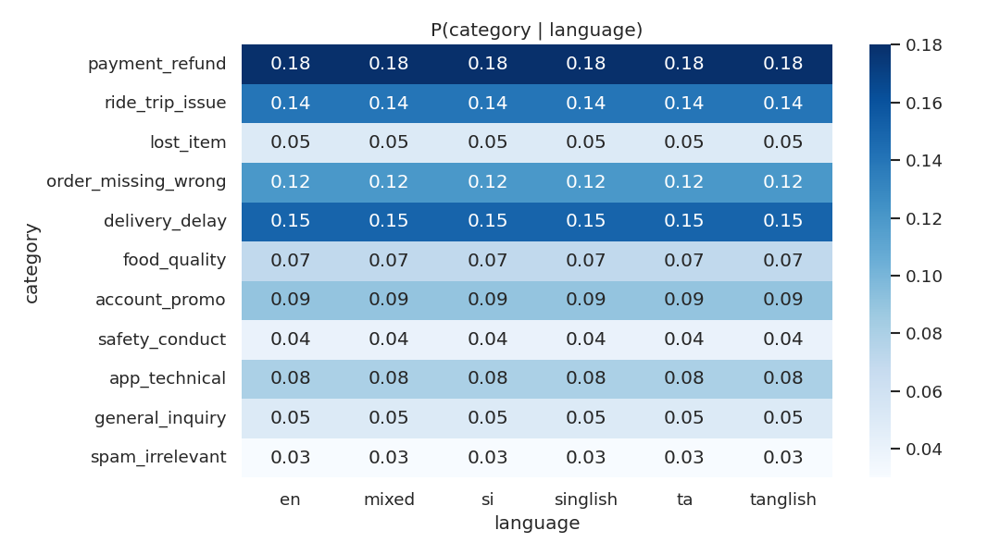
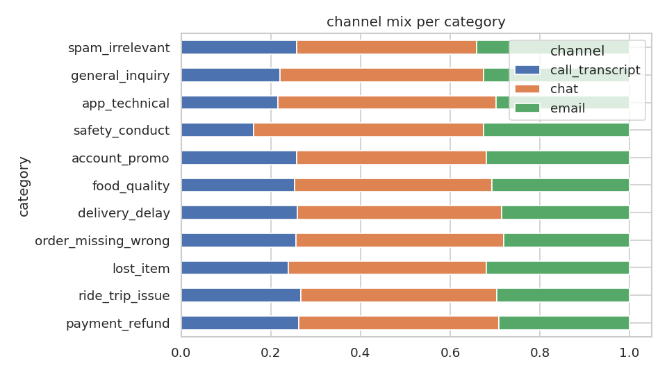
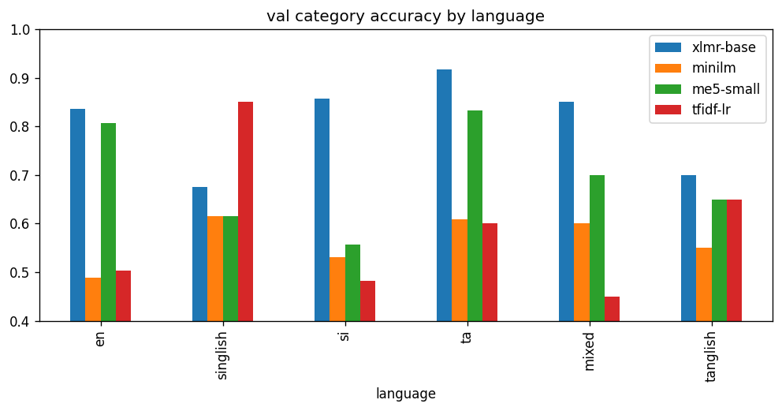
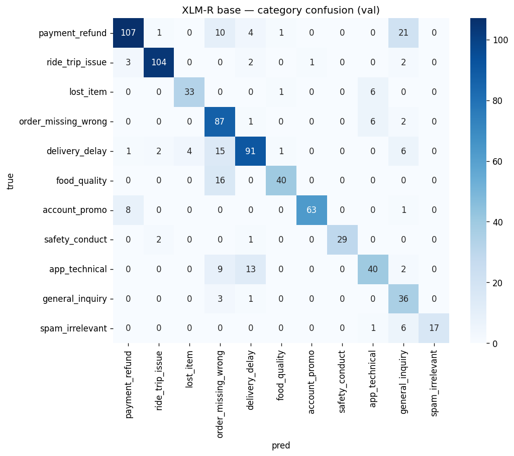
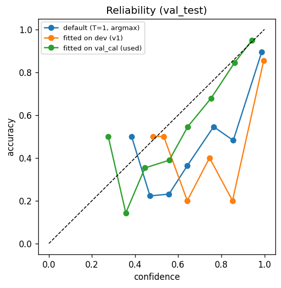
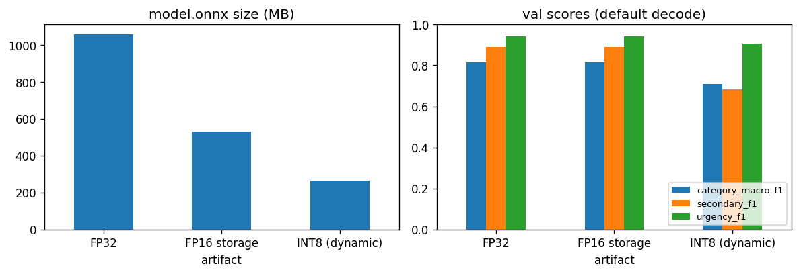

<div align="center">

# RideEat Ticket Classifier

**Multilingual customer-support ticket classification and routing**<br/>
TensorForge 2.0 · Phase 2 (MVP) submission

English · සිංහල · தமிழ் · Singlish · Tanglish · mixed script


[**Live demo**](https://main.d3tyrhj5r7v7ce.amplifyapp.com) ·
[**Hosted API**](https://d1evihbt41imfo.cloudfront.net/health) ·
[Video](#1-competition-deliverables) ·
[Report](#1-competition-deliverables) ·
[Test it locally](#2-test-it-locally)

</div>

---

RideEat is a fictional ride-hailing and food-delivery platform. Its support tickets arrive by chat, email and call
transcript, in five languages and a mix of scripts. This system reads one ticket (or 5,000) and returns:

- the **category** (11 classes) and the **team** that owns it,
- an optional **secondary issue**,
- whether it is **urgent**,
- a **calibrated confidence**,
- a **`needs_human_review`** flag for the tickets the model is unsure about.

The classifier is **our own fine-tuned XLM-RoBERTa-base with three output heads**. It makes no LLM calls. It is
exported to ONNX and served by a FastAPI engine from **one CPU-only Docker container that needs no internet at
runtime**. A separate React web client is the demo front end.

| Held-out validation (`val_test`, n = 400) | Score | | Engineering | |
|---|---|---|---|---|
| Category macro-F1 | **0.806** | | Model version | `v1.2-558395869056` |
| Urgency F1 (positive class) | **0.943** | | Model file | 530 MB (FP16 storage, FP32 compute) |
| Secondary F1 (present labels) | **0.901** | | Contract smoke test | 55 / 55 checks pass |
| Calibration error (ECE) | **0.064** (0.131 before calibration) | | Automated tests | 151 API + 11 client |

---

## Contents

1. [Competition deliverables](#1-competition-deliverables)
2. [Test it locally](#2-test-it-locally)
3. [Repository map](#3-repository-map)
4. [Architecture](#4-architecture)
5. [Training process](#5-training-process)
6. [API reference](#6-api-reference)
7. [For collaborators](#7-for-collaborators)

---

## 1. Competition deliverables

Mapped to *TensorForge 2.0 Phase 2 Guidelines*, 5.

| # | Deliverable | Where to find it | Status |
|---|---|---|---|
| 1 | **End-to-end solution** with a live front end |  **<https://main.d3tyrhj5r7v7ce.amplifyapp.com>** | ✅ Live |
| 2 | **Hosted, authenticated batch-inference endpoint** that follows the API spec exactly | **<https://d1evihbt41imfo.cloudfront.net>**: OpenAPI v2.1.0. `/health` is public, every other endpoint needs the team key | ✅ Live |
| 3 | **GitHub repository**, runnable and testable locally, with a single `docker run`, offline at runtime | This repo. `docker run -p 8000:8000 -e API_KEY=<key> tensorforge-api`. See [2](#2-test-it-locally) | ✅ |
| 4 | **Video** (15 min, YouTube unlisted): solution, architecture, evaluation | **TODO: add the YouTube link** | ⏳ |
| 5 | **Report** (max 5 pages): design decisions, evaluation scores, findings | **TODO: add the report link** | ⏳ |


---

## 2. Test it locally

This walkthrough is for testers and judges. It runs the system exactly as submitted: the API as the Docker image,
started with the contract command.

### 2.0 Prerequisites

| Tool | Needed for | Check |
|---|---|---|
| Git and **Git LFS** | Downloading the 530 MB model | `git lfs version` |
| Docker 23+ (BuildKit) | Building and running the API | `docker version` |
| ~4 GB free RAM, ~3 GB disk | The container (about 2 GB RSS under load) | |
| *Optional:* Python 3.12 | Contract smoke test and pytest | `python3 --version` |
| *Optional:* Node ≥ 22.12 | Running the web client locally | `node --version` |

The commands are for bash (Linux, macOS, or WSL2 / Git Bash on Windows).

### 2.1 Get the code and the model

```bash
git lfs install
git clone https://github.com/Dilhara11/RideEat-TensorForge-Lumora.git
cd RideEat-TensorForge-Lumora
git lfs pull
ls -lh training/models/winner/model.onnx   # about 530 MB. A file of ~130 bytes means LFS did not download it
```

### 2.2 Build and run (the contract command)

```bash
docker build -f app/server/Dockerfile -t tensorforge-api .
```

✅ The build log ends its check step with `import ok | model_version v1.2-558395869056`. That step verifies the
model bundle and its sha256.

```bash
docker run -p 8000:8000 -e API_KEY=local-test-key tensorforge-api
```

✅ The log shows `Uvicorn running on http://0.0.0.0:8000`, then `model ready: version=v1.2-558395869056` after
about 15–20 s. Leave it running and use a second terminal for the next steps.

### 2.3 Health (public, no key)

```bash
curl -s localhost:8000/health
```

✅ `{"status":"ok","model_version":"v1.2-558395869056","model_loaded":true}`. While the model is still loading,
the response is `503` with `"status":"loading"`.

### 2.4 Classify one ticket

```bash
export KEY=local-test-key
curl -s -X POST localhost:8000/predict \
  -H "X-API-Key: $KEY" -H "Content-Type: application/json" \
  -d '{"ticket_id":"T-1","channel":"chat","text":"bro mage order eka hour ekakata wada late, driver call ganne na. refund ekak denna"}'
```

✅ The response has `"category":"delivery_delay"`, `"team":"Delivery Operations"`, `"is_urgent":false`,
`confidence` ≈ 0.94, `needs_human_review:false` and `model_version` `v1.2-558395869056`. Every response has the
same keys:

```jsonc
{
  "ticket_id": "T-1",                     // echoed when sent
  "category": "delivery_delay",           // one of 11
  "secondary_category": null,             // or a category ≠ the primary; the key is always present
  "team": "Delivery Operations",          // fixed by category
  "is_urgent": false,
  "confidence": 0.94,                     // calibrated probability of the primary category
  "model_version": "v1.2-558395869056",
  "needs_human_review": false             // confidence < 0.70
}
```

<sub>Field values in this block are illustrative. The expected labels are in the text above and in the table in §2.5.</sub>

### 2.5 Classify a batch (1–100 tickets)

`Authorization: Bearer <key>` works as well as `X-API-Key`:

```bash
curl -s -X POST localhost:8000/predict/batch \
  -H "Authorization: Bearer $KEY" -H "Content-Type: application/json" \
  --data-binary @- <<'EOF'
{"tickets": [
  {"ticket_id": "B-1", "channel": "chat", "text": "anna en food romba cold ah irundhuchu, taste um sari illa"},
  {"ticket_id": "B-2", "channel": "call_transcript", "text": "customer: hello hello yes uh the driver he is um he took a wrong turn and he's not stopping the car i am scared please"},
  {"ticket_id": "B-3", "channel": "email", "subject": "Hello", "text": "Purple umbrella dances under a quiet number. I am just typing to test this box. Nothing else to add."},
  {"ticket_id": "B-4", "channel": "chat", "text": "Hi, the driver was rude and drove very fast, I felt unsafe during the ride yesterday."}
]}
EOF
```

✅ `predictions` come back in the same order, followed by `meta` (`count`, `model_version`, `processing_time_ms`).
Expected labels (recorded with `v1.2-558395869056`, confidence within about ±1% on other machines):

| Ticket | Language | `category` → `team` | Confidence | What it shows |
|---|---|---|--:|---|
| B-1 | Tanglish | `food_quality` → Restaurant Quality | ≈ 0.94 | Romanised Tamil, not urgent |
| B-2 | English call | `safety_conduct` → Trust & Safety | ≈ 0.75 | `is_urgent: true` |
| B-3 | Spam email | `spam_irrelevant` → Auto-close / Spam Filter | ≈ 0.89 | Spam rule: not urgent, `secondary_category: null` |
| B-4 | Ambiguous | `safety_conduct` → Trust & Safety | ≈ 0.67 | `needs_human_review: true` (below 0.70) |

### 2.6 Run an asynchronous job (up to 5,000 tickets)

```bash
JOB=$(curl -s -X POST localhost:8000/batch/jobs \
  -H "X-API-Key: $KEY" -H "Content-Type: application/json" \
  -d '{"tickets":[
        {"ticket_id":"J-1","channel":"chat","text":"My food never arrived and the app says delivered. I want my money back."},
        {"ticket_id":"J-2","channel":"email","subject":"Charged twice","text":"I was charged twice for my ride on 3 October. Please refund the duplicate payment."}]}' \
  | python3 -c "import sys, json; print(json.load(sys.stdin)['job_id'])")
echo "$JOB"

curl -s localhost:8000/batch/jobs/$JOB -H "X-API-Key: $KEY"                         # queued → running → succeeded
curl -s "localhost:8000/batch/jobs/$JOB/results?offset=0&limit=100" -H "X-API-Key: $KEY"
curl -s -o /dev/null -w '%{http_code}\n' -X DELETE localhost:8000/batch/jobs/$JOB -H "X-API-Key: $KEY"   # 204
```

✅ The submit returns `202` with a `Location` header. Status moves to `succeeded` within seconds, and `processed`
never decreases. Results are in request order. After the `DELETE`, the job id returns `404`.

### 2.7 Check that bad input fails correctly

```bash
curl -s -o /dev/null -w '%{http_code}\n' -X POST localhost:8000/predict \
  -H "Content-Type: application/json" -d '{"channel":"chat","text":"hi"}'                       # 401 (no key)
curl -s -o /dev/null -w '%{http_code}\n' -X POST localhost:8000/predict \
  -H "X-API-Key: $KEY" -H "Content-Type: text/plain" -d 'hello'                                # 415
curl -s -o /dev/null -w '%{http_code}\n' -X POST localhost:8000/predict \
  -H "X-API-Key: $KEY" -H "Content-Type: application/json" -d '{bad json'                      # 400
curl -s -X POST localhost:8000/predict \
  -H "X-API-Key: $KEY" -H "Content-Type: application/json" -d '{"channel":"fax","text":"   "}'  # 422
curl -s localhost:8000/nope                                                                     # 404 JSON
```

✅ Every error body has the contract shape `{"error": {"code": "...", "message": "...", "details": [...]}}`, for
example `validation_error` with one `details` entry per bad field. Bodies never contain HTML or stack traces.

### 2.8 Automated contract check (recommended)

[`smoke_test.py`](app/server/scripts/smoke_test.py) exercises every endpoint and error path and validates each body
against the official JSON Schemas:

```bash
cd app/server
python3.12 -m venv .venv && source .venv/bin/activate
pip install -r requirements-dev.txt
API_KEY=local-test-key python scripts/smoke_test.py --base-url http://localhost:8000
```

✅ It ends with **`55/55 checks passed`**. Add `--job-size 2000` to time a large job.

### 2.9 Automated test suites

```bash
# API engine (same venv as 2.8), from app/server
pytest              # 151 tests: contract, business rules, jobs, CORS, decoder parity, real model
pytest -m model     # only the tests that load the real ONNX model

# Web client, from app/client
npm ci && npm test && npm run typecheck
```

### 2.10 Optional: show it runs with no network

```bash
docker run -d --name tf-offline --network none -e API_KEY=local-test-key tensorforge-api
sleep 30
docker exec tf-offline python -c "import urllib.request; print(urllib.request.urlopen('http://127.0.0.1:8000/health').read().decode())"
docker rm -f tf-offline
```

✅ `{"status":"ok",...}` from inside a container that has no network interface except loopback.

### 2.11 Optional: the web client against your local API

```bash
# Terminal 1: the API, plus the UI's origin in CORS_ORIGINS
docker run -d --name tf-api -p 8000:8000 \
  -e API_KEY=local-test-key -e CORS_ORIGINS=http://localhost:4173 tensorforge-api

# Terminal 2: build and serve the UI as a separate static site
cd app/client
npm ci
VITE_API_BASE_URL=http://localhost:8000 npm run build
npm run preview -- --host 0.0.0.0 --port 4173 --strictPort
```

Open **<http://localhost:4173>** (use `localhost`, not `127.0.0.1`), enter `local-test-key` when asked, and try
the nine one-click samples. For batch uploads (CSV, JSON, JSONL), jobs, routing, restarts and failure cases, follow
[`app/client/TESTING.md`](app/client/TESTING.md). It lists the expected result for every step and has ready-made
test files in [`app/client/test-data/`](app/client/test-data/).

### 2.12 Test the hosted endpoint

```bash
curl -s https://d1evihbt41imfo.cloudfront.net/health
API_KEY=<team key> python app/server/scripts/smoke_test.py --base-url https://d1evihbt41imfo.cloudfront.net
```

The hosted key is the one the organizers emailed to the team leader. It is not in this repository.

### 2.13 Troubleshooting

| Symptom | Fix |
|---|---|
| The build fails at the model check (hash mismatch or invalid model) | `model.onnx` is an LFS pointer. Run `git lfs pull` and rebuild |
| `/health` returns 503 `loading` | The model is still loading. Wait ~20 s (the contract allows 120 s) |
| Every call returns 401 | `-e API_KEY=...` was missing from `docker run`, or the header has a different value |
| `port is already allocated` | Another container is on 8000: `docker ps`, then `docker stop <id>` |
| The UI says "Server unreachable" | The UI's exact origin must be in `CORS_ORIGINS` (scheme + host + port, no trailing slash) |
| Sinhala or Tamil text shows as boxes | Install Noto fonts (`fonts-noto` on Linux) |

**Clean up:** `docker rm -f tf-api`. The `tensorforge-api` image stays for next time (`docker rmi tensorforge-api` removes it).

---

## 3. Repository map

```
.
├── training/                  Model training: notebooks, shared library, results, exported model
│   ├── notebooks/             01 EDA → 02 baseline → 03 challengers → 04 compare/calibrate/export → 05 FP16
│   ├── src/tfml/              Shared code for every notebook (data, model, train loop, metrics, export, rules)
│   ├── results/               Metrics (csv/json) and every figure used in this README
│   └── models/winner/         The shipped model bundle: model.onnx (Git LFS), tokenizer, config, labels, metrics
├── app/
│   ├── server/                API engine: FastAPI + ONNX Runtime (package `tfengine`), Dockerfile, tests
│   │   ├── contract/          The organizers' OpenAPI v2.1.0 spec and JSON Schemas (source of truth)
│   │   ├── scripts/           smoke_test.py: end-to-end contract check against any running server
│   │   └── tests/             pytest suite (contract, business rules, jobs, parity, real model)
│   └── client/                Web client: React 19 + TypeScript + Vite + Tailwind 4
│       ├── TESTING.md         Step-by-step manual test of the whole system through the UI
│       └── test-data/         CSV / JSON / JSONL files for the manual tests
├── infra/                     AWS SAM templates (ECR, CodeBuild, EC2 + CloudFront, Amplify) and runbook
└── amplify.yml                AWS Amplify build spec for the web client (monorepo app root app/client)
```

Each folder has its own README with the full detail. This file is the overview and the entry point.

| Component | Detailed docs |
|---|---|
| Model training | [`training/README.md`](training/README.md) |
| API engine | [`app/server/README.md`](app/server/README.md) |
| Web client | [`app/client/README.md`](app/client/README.md) and [`app/client/TESTING.md`](app/client/TESTING.md) |
| AWS deployment | [`infra/README.md`](infra/README.md) |

---

## 4. Architecture

### 4.1 System overview

```text
   MODEL TRAINING  ·  Google Colab, offline
  ┌──────────────────────────────────────────────────────────────────────┐
  │  RideEat dataset              Notebooks 01 → 05                      │
  │  4,000 train          ──►     EDA · fine-tune · compare ·            │
  │  800 validation               calibrate · ONNX export · FP16         │
  └───────────────────────────────────┬──────────────────────────────────┘
                                      │ exports one versioned bundle
                                      ▼
            training/models/winner/   model.onnx · tokenizer · config · labels
                                      │
                                      │ copied into the image at "docker build"
                                      ▼
   ONE DOCKER CONTAINER  ·  CPU only  ·  no internet at runtime
  ┌──────────────────────────────────────────────────────────────────────┐
  │                                                                      │
  │   FastAPI engine (tfengine) ──────► ONNX Runtime                     │
  │             │                       XLM-RoBERTa base, 3 heads        │
  │             │                                                        │
  │             └─────────────────────► SQLite job store (/app/data)     │
  │                                                                      │
  └───────────────────────────────────▲──────────────────────────────────┘
                                      │ HTTPS + X-API-Key
                    ┌─────────────────┴──────────────────┐
                    │                                    │
     ┌──────────────┴──────────────┐      ┌──────────────┴──────────────┐
     │ Web client                  │      │ Judges' harness             │
     │ React 19 + Vite, on Amplify │      │ curl, scripts               │
     │ calls the API through CORS  │      │                             │
     └─────────────────────────────┘      └─────────────────────────────┘
```

The three parts are deliberately independent:

- **Training** happens offline on Colab. Its only output is a versioned model bundle.
- The **API container** copies that bundle in at build time. It never downloads anything, so the same image runs on
  a laptop, on the judges' machine and on AWS.
- The **web client** is a separate static site. The API never serves HTML (`GET /` returns a JSON service card),
  so the UI can be redeployed without touching the evaluated endpoint.

### 4.2 Inside the API container

Every request goes through the same pipeline. The checks run in the order the contract specifies (401 → 415 → 413 →
400 → 422), and invalid input can never produce a 5xx.

```text
   HTTP request
        │
        ▼
  ┌──────────────────────────────────┐
  │ RequestContextMiddleware         │   X-Request-ID echo, access log
  └────────────────┬─────────────────┘
                   ▼
  ┌──────────────────────────────────┐
  │ ApiKeyAuthenticator              ├──► 401  missing or wrong key
  │ X-API-Key or Bearer              │         (checked before the body is read)
  └────────────────┬─────────────────┘
                   ▼
  ┌──────────────────────────────────┐
  │ JsonBodyReader                   ├──► 415  not application/json
  │                                  ├──► 413  body too large
  │                                  ├──► 400  invalid JSON
  └────────────────┬─────────────────┘
                   ▼
  ┌──────────────────────────────────┐
  │ TicketValidator (Pydantic)       ├──► 422  bad fields, one detail per item
  └───────┬──────────────────┬───────┘
          │                  │
   /predict             /batch/jobs
   /predict/batch            │
          │                  ▼
          │        ┌──────────────────┐   ┌──────────────────┐   ┌──────────────────────┐
          │        │ JobManager       ├──►│ SQLiteJobStore   ├──►│ JobWorker            │
          │        │ 202 + Location   │   │ WAL mode         │   │ heartbeat, sweeper   │
          │        └──────────────────┘   └──────────────────┘   └──────────┬───────────┘
          ▼                                                                 │
  ┌──────────────────────────────────┐                                      │
  │ InferenceService                 │◄─────────────────────────────────────┘
  │ one inference lane, FIFO chunks  │
  └────────────────┬─────────────────┘
                   ▼
  ┌──────────────────────────────────┐
  │ OnnxTicketClassifier             │
  │ encode → ONNX → decode rules     │
  └────────────────┬─────────────────┘
                   ▼
               200 JSON
```

| Property | How it is achieved |
|---|---|
| **Deterministic and batch-invariant** | One ticket per forward pass, so a ticket gets the same answer from `/predict`, `/predict/batch` and a job, in any order. The tests check this |
| **Responsive while a 5,000-ticket job runs** | All model calls share one inference thread, and jobs run in chunks of 2 tickets. A `/predict` waits for at most one chunk, and `/health` never touches the model |
| **Jobs survive and fail correctly** | Job state is in SQLite (WAL). Queued jobs survive a restart. A job that was running when the process died is marked `failed` with `error.code = "interrupted"` within 30 s (heartbeat) |
| **`model_version` is tied to the artifact** | `inference_config.json` stores the sha256 of `model.onnx`. The engine checks it at build time and at start-up, and returns the same version on every endpoint |
| **No secrets or ticket text in logs** | The key is compared in constant time and never logged. Logs carry request ids, never ticket text |

Measured on a local machine pinned to 2 cores, which is the size of the contract's reference box (full table in [`app/server/README.md`](app/server/README.md#measured-local-wsl2-pinned-to-2-cores-with-taskset-model-v12-558395869056)):

| Check | Contract target | Measured |
|---|---|---|
| `/health` 200 after container start | ≤ 120 s | 17 s |
| `/predict` p50 / p95 (idle) | p95 < 1 s | 140 ms / 274 ms |
| `/predict/batch`, 100 tickets | < 30 s | 16.4 s |
| 5,000-ticket job | < 30 min | 15.1 min |
| `/predict` p95 while a job runs | < 1 s | 564 ms |
| Memory after the 5,000-ticket job | 4 GB box | ~2.0 GB |

### 4.3 The model at inference time

```text
     channel + subject                                             ticket text
     header: "chat",  or  "email </s> <subject>"                     body
              │                                                        │
              └─────────────────────────────┬──────────────────────────┘
                                            │ sentence pair · NFC + whitespace cleanup
                                            │ max 192 tokens, only the body is truncated
                                            ▼
                       ┌──────────────────────────────────────────┐
                       │ XLM-RoBERTa base  (shared encoder)       │
                       └────────────────────┬─────────────────────┘
                                            │ CLS vector, 768-d
                   ┌────────────────────────┼────────────────────────┐
                   ▼                        ▼                        ▼
          ┌─────────────────┐      ┌─────────────────┐      ┌─────────────────┐
          │ Category head   │      │ Secondary head  │      │ Urgency head    │
          │ 11 classes      │      │ 11 + "none"     │      │ 2 classes       │
          └────────┬────────┘      └────────┬────────┘      └────────┬────────┘
                   └────────────────────────┼────────────────────────┘
                                            ▼
          ┌───────────────────────────────────────────────────────────────────┐
          │ PredictionDecoder  (business rules)                               │
          │  1. category   = argmax of softmax(logits / T), T = 1.595         │
          │     confidence = probability of that category                     │
          │  2. secondary  = best class other than the category,              │
          │                  kept only if p ≥ 0.40, otherwise null            │
          │  3. is_urgent  = P(urgent) ≥ 0.425                                │
          │  4. spam       → is_urgent = false, secondary = null              │
          │  5. team       = fixed lookup from the category                   │
          │  6. needs_human_review = confidence < 0.70                        │
          └─────────────────────────────────┬─────────────────────────────────┘
                                            ▼
                                       API response
```

- **Inputs are `channel`, `subject` and `text` only.** The dataset has a `language` column, but the API never
  receives it, so it is used only for analysis and stratified splits.
- **One backbone, three heads.** One forward pass answers all three questions, and the heads share what the encoder
  learns. The loss is `CE_category + 0.5·CE_secondary + 0.3·CE_urgency`.
- **The business rules are code, not hopes.** The decoder in the engine mirrors `training/src/tfml/rules.py`
  exactly ([`test_decoder_parity.py`](app/server/tests/test_decoder_parity.py)). A defensive second pass makes sure
  that no response can break a consistency rule: secondary ≠ category, spam ⇒ not urgent with no secondary, and the
  team always matches the category.

### 4.4 Asynchronous batch jobs

```text
   POST /batch/jobs ──► 202 + job_id
                             │
                             ▼
                        ┌─────────┐ worker claims ┌─────────┐ every ticket done  ┌───────────┐
                        │ queued  ├──────────────►│ running ├───────────────────►│ succeeded │
                        └────┬────┘               └──┬───┬──┘                    └────┬──────┘
                             │                       │   │                            │
                      DELETE │                DELETE │   │ process restarted          │ kept 6 h
                             │                       │   │ mid-job                    │ then 410
                             ▼                       ▼   ▼                            ▼
                        ┌─────────────────────────────┐ ┌──────────────────────┐ ┌───────────┐
                        │ cancelled                   │ │ failed               │ │ expired   │
                        └─────────────────────────────┘ │ error.code =         │ └───────────┘
                                                        │ "interrupted"        │
                                                        └──────────────────────┘
```

- Capacity is **1 running + 3 queued**. Above that the API answers `429` with `Retry-After`.
- Every ticket is validated **before** a job is created. One bad item returns `422` with its index, and no job is created.
- `Idempotency-Key` is supported. `processed` never decreases. Results come back in request order, paged with
  `offset` and `limit`.

### 4.5 Cloud deployment (AWS, `ap-south-1`)

```text
                                                       loads the UI   ┌─────────────────────┐
       Judges' harness                     Browser ──────────────────►│ AWS Amplify Hosting │
              │                               │         HTTPS         │ static React build  │
              │ HTTPS                         │ HTTPS: fetch          └─────────────────────┘
              │                               │ + X-API-Key (CORS)
              ▼                               ▼
  ┌─────────────────────────────────────────────────────────────────────┐
  │ Amazon CloudFront   https://d1evihbt41imfo.cloudfront.net           │
  │ valid TLS · no caching                                              │
  └──────────────────────────────────┬──────────────────────────────────┘
                                     │ HTTP :8000, only CloudFront IPs allowed
                                     ▼
  ┌─────────────────────────────────────────────────────────────────────┐   ┌────────────────────────┐
  │ EC2 t4g.medium   2 vCPU · 4 GB · Graviton (arm64)                   │◄──┤ SSM Parameter Store    │
  │   systemd ──► docker run -p 8000:8000 ... <ECR image:tag>           │   │ API key (SecureString) │
  │               job store on the tf-jobs volume (/app/data)           │   └────────────────────────┘
  └─────────────────▲────────────────────────────────────┬──────────────┘
                    │ pull by immutable tag              │ logs
  ┌─────────────────┴───────────────┐          ┌─────────▼─────────┐
  │ Amazon ECR                      │          │ CloudWatch Logs   │
  │ multi-arch image, amd64 + arm64 │          └───────────────────┘
  └─────────────────▲───────────────┘
                    │ push, inside AWS
  ┌─────────────────┴───────────────┐
  │ AWS CodeBuild                   │
  │ native amd64 + arm64 builds     │
  └─────────────────▲───────────────┘
                    │ clone the commit + the Git LFS model
  ┌─────────────────┴───────────────┐
  │ GitHub repository               ├──► branch main ──► AWS Amplify rebuilds the UI on every push
  └─────────────────────────────────┘
```

- **The same image as the submitted container.** CodeBuild builds `app/server/Dockerfile` from a pushed commit, the
  same command judges run locally, and the instance pulls it by an immutable tag.
- **Why EC2 behind CloudFront:** it matches the contract's reference box (2 vCPU, 4 GB) at about $1 a day, and
  CloudFront gives a stable HTTPS URL with valid TLS. Port 8000 accepts traffic only from CloudFront.
- **Why the image is built inside AWS:** pushing a ~1 GB image from a home connection failed after 46 minutes.
  CodeBuild pulls the commit (and the LFS model) from GitHub instead.
- **Parity gate:** before the URL was submitted, the same tickets were sent to a local amd64 container and to the
  hosted arm64 one. The labels must be identical ([`infra/scripts/parity_check.py`](infra/scripts/parity_check.py)).

Everything is infrastructure as code: [`infra/`](infra/) has four SAM stacks and a step-by-step runbook.

### 4.6 Key design decisions

| Decision | Why |
|---|---|
| Fine-tuned encoder, not an LLM | The guidelines discourage wrapping an LLM. A 3-head encoder is small enough to run offline on 2 CPUs and gives a confidence we can calibrate |
| XLM-RoBERTa vocabulary | Sinhala and Singlish are 45% of the data. IndicBERT, which was in the first plan, has no Sinhala, so it was replaced before any training |
| ONNX Runtime on CPU | No torch in the image. Starts in seconds, runs deterministically, one model copy fits in 4 GB |
| SQLite job store | Job state survives restarts and is shared across workers with no extra service, so `docker run` stays a single command |
| UI separate from the API | The evaluated container stays minimal and API-only. The UI can change without risking the endpoint |
| Latency as a gate, not a score | The guidelines score correctness, schema compliance and robustness. Latency targets are met, but they never decided which model won |

---

## 5. Training process

The full pipeline is five notebooks that run on Google Colab (T4 GPU for training, CPU for export) and share one
library, [`training/src/tfml/`](training/src/tfml/). Every number and figure below comes from
[`training/results/`](training/results/) and [`training/models/winner/metrics.json`](training/models/winner/metrics.json).

```text
           ┌─────────────────────────────────────────────┐
           │ NB01  EDA and preprocessing           (CPU) │
           │ train / dev / val splits · max_length = 192 │
           └──────────────────────┬──────────────────────┘
                  ┌───────────────┴────────────────┐
                  ▼                                ▼
  ┌──────────────────────────────┐ ┌──────────────────────────────┐
  │ NB02  Baseline      (T4 GPU) │ │ NB03  Challengers   (T4 GPU) │
  │ XLM-RoBERTa base, 3 heads    │ │ MiniLM · mE5-small · TF-IDF  │
  └───────────────┬──────────────┘ └───────────────┬──────────────┘
                  └───────────────┬────────────────┘
                                  ▼
           ┌─────────────────────────────────────────────┐
           │ NB04  Compare · calibrate · export    (CPU) │
           │ winner on dev · temperature + thresholds    │
           │ on val_cal · ONNX export · INT8 check       │
           └──────────────────────┬──────────────────────┘
                                  ▼
           ┌─────────────────────────────────────────────┐
           │ NB05  FP16-storage compression        (CPU) │
           │ accepted only if no score drops             │
           └──────────────────────┬──────────────────────┘
                                  ▼
            training/models/winner/  ·  v1.2-558395869056
```

### 5.1 The data

4,000 training and 800 validation tickets. They are synthetic, with deliberately messy grammar, transliteration
and code-mixing.

<p align="center">
  
</p>

| | |
|:-:|:-:|
|  |  |
| English 35%, Singlish 25%, Sinhala 20%, Tamil 15%, Tanglish and mixed 2.5% each. Train and validation match | Urgency is 10% overall, but 75% of `safety_conduct`. Four categories are never urgent |

<p align="center">
  
</p>

**What the EDA decided:**

- **`max_length = 192`**, measured rather than guessed: p99.5 of the real token counts is 188. Sinhala and Tamil
  script split into more tokens per character than English.
- **Classes are imbalanced** (720 → 120 per class), so the headline metric is **macro**-F1.
- **Only 10% of tickets have a secondary label**, so always predicting "none" would score about 90% accuracy.
  Secondary is therefore reported as **F1 on the tickets that have one**.
- **The category mix is identical in every language and nearly identical in every channel**, so neither is a
  shortcut. The model has to read the text.

<details>
<summary>More EDA figures: category by language, channel by category</summary>

| | |
|:-:|:-:|
|  |  |

</details>

### 5.2 Four splits, four jobs

```text
   train.jsonl       4,000 ─┬─► train      3,600   fit the weights
                            └─► dev          400   pick the epoch and the model

   validation.jsonl    800 ─┬─► val_cal      400   fit temperature and thresholds
                            └─► val_test     400   held out: every reported number
```

`dev` is a stratified 10% of train (category × language, seed 42). The official validation set is split 50/50,
stratified by category. Half calibrates and half is touched only for the final score. Section 5.10 explains why
this split was introduced.

### 5.3 Candidates and training set-up

| Role | Model | Why it was tried |
|---|---|---|
| **Baseline** | `FacebookAI/xlm-roberta-base` (CLS pooling) | Strong multilingual encoder whose vocabulary covers Sinhala and Tamil |
| Challenger A | `microsoft/Multilingual-MiniLM-L12-H384` | About 3× faster, same vocabulary |
| Challenger B | `intfloat/multilingual-e5-small` | Sentence-level pre-training, XLM-R vocabulary. Replaced IndicBERT, which has no Sinhala |
| Reference | TF-IDF (character + word n-grams) + Logistic Regression | Classical baseline that shows what the transformers add |

All three transformers use the same 3-head architecture, splits and loop: AdamW, 5 epochs, batch size 16, 10%
warm-up, weight decay 0.01, gradient clipping 1.0, mixed precision, seed 42. The learning rate is 2e-5 for XLM-R
and 5e-5 for the two 384-d models, which under-fit at 2e-5. Training resumes after a Colab disconnect, because a
checkpoint is written after every epoch.

### 5.4 Learning curves (XLM-R base, dev set)

| Epoch | Train loss | Category macro-F1 | Secondary F1 | Urgency F1 | ECE |
|:-:|:-:|:-:|:-:|:-:|:-:|
| 1 | 2.503 | 0.632 | 0.000 | 0.000 | 0.074 |
| 2 | 0.613 | 0.986 | 0.063 | 0.529 | 0.033 |
| 3 | 0.197 | 0.989 | 0.857 | 0.676 | 0.018 |
| 4 | 0.078 | 0.993 | 0.984 | 0.978 | 0.012 |
| **5** | **0.044** | **0.996** | **0.984** | **0.989** | **0.009** |

The category head converges by epoch 2. The two rare-label heads (secondary and urgency, about 10% positives each)
need epochs 3–4. About 50 s per epoch on a T4. The full histories for every model are in
`training/results/*_history.csv`.

### 5.5 Choosing the winner

The winner score uses **correctness only**: `0.5 · macro-F1(category) + 0.25 · F1(secondary) + 0.25 · F1(urgency)`.
The winner was picked on **dev**. Validation numbers are the held-out check.

| Model | Size | Dev score | **Val score** | Val category acc | Val macro-F1 | Val secondary F1 | Val urgency F1 |
|---|--:|--:|--:|--:|--:|--:|--:|
| **XLM-R base** ✅ | 1,059 MB | 0.991 | **0.865** | **0.809** | **0.814** | **0.890** | **0.943** |
| mE5-small | 448 MB | 0.707 | 0.536 | 0.706 | 0.729 | 0.458 | 0.229 |
| MiniLM | 448 MB | 0.345 | 0.286 | 0.551 | 0.423 | 0.298 | 0.000 |
| TF-IDF + LR (reference) | 5 MB | 0.972 | 0.686 | 0.603 | 0.625 | 0.621 | 0.874 |

<sub>Full validation set (n = 800), default decoding, before calibration. Source: [`results/metrics.csv`](training/results/metrics.csv), [`results/selection.csv`](training/results/selection.csv).</sub>

<p align="center">
  
</p>

XLM-R base wins in every language except Singlish, where TF-IDF character n-grams do better (0.85 vs 0.68).
That points to the most promising next experiment: an ensemble (see [§7.6](#76-open-problems-good-first-contributions)).

### 5.6 Final held-out results (shipped model `v1.2`)

| Metric (`val_test`, n = 400, never used for any decision) | Score |
|---|--:|
| Category accuracy | 0.803 |
| Category macro-F1 / weighted-F1 | **0.806** / 0.810 |
| Secondary F1 on present labels (precision / recall) | **0.901** (1.000 / 0.821) |
| Secondary exact accuracy, including "none" | 0.983 |
| Urgency F1, positive class (precision / recall) | **0.943** (0.917 / 0.971) |
| All three labels exactly right | 0.790 |
| Expected calibration error (ECE) | **0.064** |
| Flagged `needs_human_review` · accuracy on the rest | 18.75% · **89.9%** |

On the full validation set (n = 800, slightly optimistic because half of it fitted the calibration): accuracy 0.809,
macro-F1 0.814, urgency F1 0.957, ECE 0.052. The served API reproduces **0.80875** category accuracy end to end,
the same as the notebook.

<p align="center">
  
</p>

The errors cluster at the labelling-rule boundaries the dataset notes spell out: `payment_refund` → `general_inquiry`
(21), `food_quality` → `order_missing_wrong` (16), `delivery_delay` → `order_missing_wrong` (15) and
`app_technical` → `delivery_delay` (13).

**Against the targets we set ourselves before training** (from [`results/success_criteria.csv`](training/results/success_criteria.csv)):

| Criterion | Target | Result | |
|---|---|---|:-:|
| Category macro-F1 | ≥ 0.85 | 0.806 | ❌ |
| Secondary accuracy (F1 on present labels also reported) | ≥ 0.80 | 0.983 (F1 0.901) | ✅ |
| Urgency F1 | ≥ 0.90 | 0.943 | ✅ |
| Every language within 10 pt of English | ≤ 10 pt | Singlish −16, Tanglish −33 (n = 12) | ❌ |
| Confidence calibration, ECE | < 0.05 | 0.064 (from 0.131) | ❌ |
| CPU p95, single ticket, 2 threads | < 800 ms | 552 ms | ✅ |
| 100-ticket batch | < 30 s | 25.8 s | ✅ |
| Packaged model | < 2 GB | 546 MB after FP16 | ✅ |
| Business-rule violations | 0 | 0 | ✅ |
| Deterministic and batch-invariant | yes | yes | ✅ |

The three misses are reported as they are. They are the open problems in [§7.6](#76-open-problems-good-first-contributions).

### 5.7 Calibration and the `needs_human_review` threshold

`confidence` is the probability of the predicted **primary** category after **temperature scaling**
(`T = 1.595`). The contract uses it for calibration and abstention scoring, so it has to mean what it says.

<p align="center">
  
</p>

| Decode settings, scored on `val_test` | Temperature | ECE | Mean confidence | Urgency F1 |
|---|--:|--:|--:|--:|
| Default (T = 1, argmax) | 1.000 | 0.131 | 0.931 | 0.928 |
| Fitted on dev (first attempt, v1.0) | 0.565 | 0.165 ❌ worse | 0.968 | 0.932 |
| **Fitted on `val_cal` (shipped)** | **1.595** | **0.062** | **0.830** | **0.943** |

These rows were scored in NB04 on the FP32 model. The shipped FP16 model has ECE 0.064 with the same settings.
Fitting on dev made calibration *worse*. The model is ~99.6% accurate on dev, so the fit sharpened confidences the
model hadn't earned on new data. Fitting on half of the validation set fixed it. Temperature never changes which
category wins, so accuracy is identical in all three rows.

**How the review threshold was chosen.** `needs_human_review = confidence < τ`, with **τ = 0.70**
(`inference_config.json → decode.review_threshold`). The rule was fixed before looking at the result: choose the
smallest τ at which the tickets that are **not** flagged reach ≥ 97% category accuracy, while flagging **at most
20%** of tickets for review. No threshold reaches 97% inside that budget (τ = 0.90 still flags 47% and reaches 95%),
so the budget decides, and the largest τ that flags ≤ 20% on `val_cal` is 0.70:

| τ | Flagged (`val_cal`) | Accuracy of the auto-routed rest |
|--:|--:|--:|
| 0.50 | 6.0% | 84.0% |
| 0.60 | 12.0% | 87.2% |
| **0.70** | **19.8%** | **90.7%** |
| 0.80 | 30.3% | 92.1% |
| 0.90 | 46.8% | 95.3% |

On the held-out `val_test`, τ = 0.70 flags **18.75%** of tickets. The rest are **89.9%** correct, compared with
80.3% for all tickets. In practice an agent checks about one ticket in five, and those are the ones most likely to
be wrong. The web client shows this threshold as the 70% marker on the confidence bar.

### 5.8 Making it fit: FP16-storage compression

<p align="center">
  
</p>

| Artifact | Size | Category macro-F1 | Secondary F1 | Urgency F1 | Decision |
|---|--:|--:|--:|--:|---|
| FP32 ONNX | 1,059 MB | 0.814 | 0.890 | 0.943 | Shipped as v1.1 |
| **FP16 storage, FP32 compute** | **530 MB** | **0.814** | **0.890** | **0.943** | ✅ **Shipped as v1.2** |
| INT8 dynamic quantization | 266 MB | 0.711 | 0.682 | 0.905 | ❌ Rejected: −10.3 pt |

INT8 looked almost free on dev (−2.65 pt) but cost 10.3 pt on validation, so NB04 rejected it. NB05 instead stores
each weight as float16 and casts it back to float32 when ONNX Runtime loads the model, so the computation is
unchanged. The acceptance rule was written **before** running: category agreement ≥ 99.5% and every |Δ| ≤ 0.005.
The result was **100% agreement** on all 800 validation tickets for category, secondary, urgency and review flag,
with a largest confidence change of 0.0034.

### 5.9 Reproduce the training

1. Upload `training/` to Google Drive as `MyDrive/TensorForge/training/`.
2. Put `train.jsonl` and `validation.jsonl` from the organizers' resource pack in `MyDrive/TensorForge/training/data/`.
   The dataset is not redistributed in this repository.
3. Run the notebooks in order: **01** (CPU) → **02** and **03** (T4 GPU) → **04** and **05** (CPU runtime, like
   the deployment box). The first cell of each one mounts Drive and installs `requirements-colab.txt`.

The full guide, including running locally with `training/requirements.txt`, is [`training/README.md`](training/README.md).

### 5.10 How the model was improved

The training process went through three runs, and each review changed the method, not just the numbers:

| Stage | What we found | What we changed |
|---|---|---|
| **Plan review** (before any training) | 15 issues in the original plan. Examples: IndicBERT has no Sinhala, latency was part of the winner score although it isn't scored, there was no calibration step, and the same 800 rows were used both to tune and to report | Swapped in mE5-small. Correctness-only winner score. Added the dev split, calibration, sentence-pair input, measured `max_length` and the TF-IDF reference |
| **Run 1 → v1.0** | NB04 exported **mE5-small**, because XLM-R, which was best on every metric, missed a 100-ticket batch-time gate by 0.12 s (measured on PyTorch, before export). Dev-fitted calibration pushed validation ECE from 0.089 to 0.252 | **v1.1:** batch time reported but no longer a gate. Validation split into `val_cal` / `val_test`. The INT8 check uses the worse of the dev and validation drops |
| **Run 2 → v1.1b** | XLM-R excluded again, by a p95 latency gate. The same checkpoint measured 585 ms in run 1 and 1,017 ms in run 2 (shared Colab CPU noise). The review flag fired on 98% of tickets | Only the size gate kept. 20% review budget. A fail-fast check for a stale runtime copy on Drive |
| **Run 3 → v1.1** | XLM-R selected on merit. INT8 lost 10.3 pt, so FP32 shipped at 1.06 GB | (accepted) |
| **v1.2** | 1.06 GB made the image, the Git LFS quota and every deploy heavy | NB05: FP16 storage with a pre-registered acceptance test. Half the size, identical predictions |

### 5.11 Findings

1. **Dev is saturated and validation is not.** Three of the four models reach ≥ 0.99 category accuracy on dev, but
   on validation they reach 0.81 (XLM-R), 0.71 (mE5-small) and 0.60 (TF-IDF). Dev comes from the same pool as the
   training data, so it can't separate strong models. That is why no dev number is reported as a result.
2. **Calibration must be fitted on data the model hasn't effectively memorised.** Fitting on dev made ECE worse.
3. **Quantization has to be checked on held-out data.** INT8 hid a 10-point loss behind a 2.65-point dev drop.
4. **Code-mixed romanised text is the weak spot.** Singlish (0.67) and Tanglish (0.50, only 12 tickets) are well
   below English (0.83), while native Sinhala and Tamil script do well (0.83 and 0.93).
5. **Some errors are confident.** For example, a Tamil "item didn't arrive, give the money back" ticket is predicted
   `payment_refund` at 97%. The labelling rules say `order_missing_wrong`. The review flag can't catch errors like
   this, so they need better training data, not a different threshold.

---

## 6. API reference

Contract: OpenAPI **v2.1.0**, [`app/server/contract/tensorforge-phase2-openapi-v2.yaml`](app/server/contract/tensorforge-phase2-openapi-v2.yaml).
A running container also serves interactive docs at `/docs`.

| Endpoint | Auth | Purpose |
|---|---|---|
| `GET /health` | public | `{"status","model_version","model_loaded"}`. 503 while loading |
| `POST /predict` | key | One ticket → one prediction |
| `POST /predict/batch` | key | 1–100 tickets (unique `ticket_id`), predictions in the same order, body ≤ 5 MB |
| `POST /batch/jobs` | key | 1–5,000 tickets, body ≤ 25 MB → `202` + `job_id`, `Location`, `Retry-After`. Supports `Idempotency-Key` |
| `GET /batch/jobs/{id}` | key | `queued` / `running` / `succeeded` / `failed` / `cancelled`, `total`, `processed` |
| `GET /batch/jobs/{id}/results` | key | Paged with `offset` / `limit`. `409` before success, `410` after expiry |
| `DELETE /batch/jobs/{id}` | key | Cancel or discard → `204` |

**Request:** `channel` ∈ `email` · `chat` · `call_transcript` (required), `text` (1–10,000 characters, not just
whitespace), `subject` (≤ 500, optional), `ticket_id` (≤ 64, echoed back). Extra fields are accepted and ignored.

**Auth:** `X-API-Key: <key>` or `Authorization: Bearer <key>`.

**Category → team** (fixed by the contract):

| Category | Team | Category | Team |
|---|---|---|---|
| `payment_refund` | Payments & Refunds | `food_quality` | Restaurant Quality |
| `ride_trip_issue` | Ride Operations | `account_promo` | Account Services |
| `lost_item` | Lost & Found | `safety_conduct` | Trust & Safety |
| `order_missing_wrong` | Food Operations | `app_technical` | Tech Support |
| `delivery_delay` | Delivery Operations | `general_inquiry` | Front-line Support |
| `spam_irrelevant` | Auto-close / Spam Filter | | |

**Configuration:** everything is an environment variable with a safe default. Only `API_KEY` is required. The
optional ones are `CORS_ORIGINS`, `ONNX_THREADS`, `JOB_CHUNK_SIZE`, job capacity and retention, and `LOG_LEVEL`. The
full table is in [`app/server/README.md`](app/server/README.md#configuration-environment-variables), with a template
in [`app/server/.env.example`](app/server/.env.example). To keep jobs when the container is re-created, mount a
volume: `-v tf-jobs:/app/data`.

---

## 7. For collaborators

Welcome! This section is the path from a fresh clone to a useful first change.

### 7.1 Start here

1. Read this README up to here. It covers the whole system in one place.
2. Run [§2](#2-test-it-locally) once, end to end. Seeing the real outputs is the fastest way to understand the system.
3. Read the README of the part you'll work on ([training](training/README.md) · [server](app/server/README.md) ·
   [client](app/client/README.md) · [infra](infra/README.md)), then the contract in
   [`app/server/contract/`](app/server/contract/).
4. Ask a teammate for the competition dataset and the local `Resources/` folder (organizer PDF and the team's
   design plans). Both are deliberately git-ignored.

### 7.2 Development set-up

| Part | Set-up | Day-to-day loop |
|---|---|---|
| **Training** | Google Colab (see [§5.9](#59-reproduce-the-training)). Locally: `pip install -r training/requirements.txt` | Edit `training/src/tfml/`, then re-run the notebooks on Colab |
| **API engine** | Python 3.12: `cd app/server && python3.12 -m venv .venv && source .venv/bin/activate && pip install -r requirements-dev.txt` | `pytest` (seconds, fake classifier) → `docker build` → `smoke_test.py` |
| **Web client** | Node ≥ 22.12: `cd app/client && npm ci` | `npm run dev` (http://localhost:5173, proxies to the API on :8000) → `npm test` → `npm run typecheck` |
| **Infrastructure** | AWS CLI + SAM CLI, access to the team's AWS account | Follow [`infra/README.md`](infra/README.md) |

Always run the API as the **Docker image** when testing behaviour. That is what judges run, and it is what the
hosted endpoint runs.

### 7.3 Ground rules

1. **The contract is the law.** Field names, enums, status codes and error shapes come from
   [`app/server/contract/`](app/server/contract/). If a change makes a schema test fail, the change is wrong, not the test.
2. **Any model change gets a new `model_version`.** The version is `v<major.minor>-<sha256[:12]>` of `model.onnx`, and
   the build refuses a mismatch. Never edit `inference_config.json` by hand to make it pass.
3. **Training and serving must agree.** Input formatting (`tfml/textproc.py`) and decoding (`tfml/rules.py`) are
   mirrored in the engine. If you change one side, change the other. `test_decoder_parity.py` will catch a mismatch.
4. **Ship the tokenizer that was exported with the model.** A tokenizer taken from elsewhere can encode the
   `channel </s> subject` header differently. In one test, a Hugging Face hub copy changed about 30% of predictions.
5. **The container stays offline and CPU-only.** No runtime downloads, no torch in the image.
6. **Secrets never enter git.** The real key goes in `app/server/.env` (git-ignored) or SSM. Never put a key in an
   example, a test, a log line or a commit message.
7. **Report results honestly.** Selection on dev, calibration on `val_cal`, reported numbers from `val_test` only.

### 7.4 Workflow

- `main` is what is deployed and submitted. Do all work on a short-lived branch, e.g. `feature/<topic>` or `fix/<topic>`.
- `model.onnx` is tracked by **Git LFS** (`.gitattributes`), so install LFS before your first commit that touches the model.
- Before opening a pull request, run the checks for the parts you changed:
  `pytest` · `docker build` + `smoke_test.py` · `npm test` + `npm run typecheck` · `sam validate --lint` (infra).
- The PR description should say what changed, how you tested it, and whether `model_version` or the contract
  behaviour changed.
- **During the evaluation window, don't deploy, restart or load-test the hosted API.** A restart interrupts any
  running job, and judges may be running one.

### 7.5 Common tasks

<details>
<summary><b>Train or improve the model</b></summary>

1. Change `training/src/tfml/` or a notebook. Keep the three-head output contract (`category_logits`,
   `secondary_logits`, `urgency_logits`).
2. Run NB01 → NB05 on Colab. NB04 picks the winner on dev, calibrates on `val_cal`, scores on `val_test` and writes
   `training/models/winner/`. NB05 compresses it only if no score drops.
3. Copy the **whole** bundle from Drive into `training/models/winner/`, including `tokenizer/` and
   `inference_config.json`.
4. `cd app/server && pytest -m model`, then `docker build ...`. The build checks the sha256, and `smoke_test.py`
   checks the contract against the new container.
5. Record the new scores in the README tables and in the report.

</details>

<details>
<summary><b>Change the API engine</b></summary>

1. Code lives in `app/server/tfengine/`. [`engine.py`](app/server/tfengine/engine.py) is the composition root,
   and tests inject a fake classifier there, so most tests run in seconds without the model.
2. Add or adjust tests in `app/server/tests/`. Response bodies are validated against the official schemas.
3. `pytest` → `docker build` → `smoke_test.py` against the container.

</details>

<details>
<summary><b>Change the web client</b></summary>

1. Code lives in `app/client/src/`: views are in `features/`, API calls and contract types in `lib/`.
2. `npm run dev` against a local API container, then `npm test` and `npm run typecheck`.
3. Pushing to the branch Amplify serves (`main`) rebuilds and redeploys the live demo automatically, using
   [`amplify.yml`](amplify.yml). The unit tests gate that deploy.

</details>

<details>
<summary><b>Ship a new version to AWS</b></summary>

Commit and push (including LFS) → `infra/scripts/cloud-build.sh` (builds amd64 + arm64 in CodeBuild) → set
`ImageTag` in `infra/samconfig.toml` → `sam deploy --config-env api` → `infra/scripts/restart-api.sh` → run the
go/no-go gates. Details and troubleshooting: [`infra/README.md`](infra/README.md).

</details>

### 7.6 Open problems (good first contributions)

| Problem | Evidence | Ideas |
|---|---|---|
| Category macro-F1 is 0.81, below our 0.85 target | [§5.6](#56-final-held-out-results-shipped-model-v12) | Train on train + `val_cal` for the final model. Try a larger backbone that still fits the 2-vCPU box |
| Singlish (0.67) and Tanglish (0.50) lag English (0.83) | [Per-language figure](#55-choosing-the-winner) | **Ensemble XLM-R with the TF-IDF model**, which reaches 0.85 on Singlish. Augment with transliteration variants |
| Confusions at labelling-rule boundaries | [Confusion matrix](#56-final-held-out-results-shipped-model-v12) | Targeted examples for refund vs. missing item vs. delay, and for `general_inquiry` |
| ECE 0.064, target < 0.05 | [§5.7](#57-calibration-and-the-needs_human_review-threshold) | Per-class temperature, or vector scaling on `val_cal` |
| Confident mistakes bypass human review | [§5.11](#511-findings) | Add review triggers beyond confidence, e.g. disagreement between the primary and secondary heads |

---

<div align="center">
<sub>
Built for <b>TensorForge 2.0</b>, organised by the IEEE Computer Society KDU chapter.<br/>
The dataset is synthetic and provided by the organizers. It describes the fictional RideEat platform, has not been
reviewed by native speakers, and is not redistributed in this repository.
</sub>
</div>
